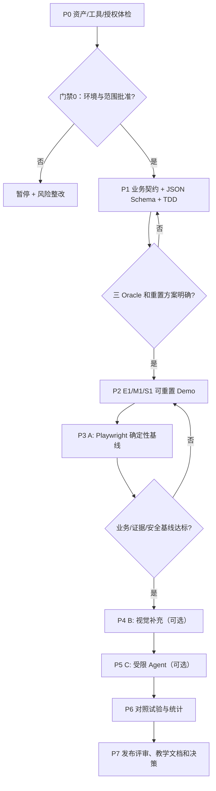

# 02｜端到端实施流程（P0–P7）

## 流程表

| 阶段 | 主要活动 | 主要交付 | 退出门禁 |
|---|---|---|---|
| P0 | 读包、检查 Git/Node/OS、确定隔离 Scope、核对工具 API 与许可 | `reports/P0_READINESS.md` | 无生产访问、边界清晰、测试预算明确 |
| P1 | 冻结示例规则，定义状态机、接口、Oracle、JSON Schema | Contract Tests + ADR | Schema 测试通过；不变量可判定；未定义规则标注 Unknown |
| P2 | 三个 Demo 场景与 Clock/Seed/Reset | 可复位环境 + API + UI | 运行 2 次 Reset 后结果一致，沙盒写操作不逸出 |
| P3 | Playwright Test 基线；可选 AI 辅助 CLI | 有效测试 + Trace + 数据核对 | P0 不变量被独立断言，数据可清理，失败可复现 |
| P4 | Midscene/视觉辅助探索 | 视觉发现、截图、对照报告 | 错误视觉结论不会改变业务真相；人工许可成本 |
| P5 | 有界 Agent Charter、动作 Policy、Budget、Verifier | Candidate Findings、独立复现证据 | 越界动作阻断，成本/步骤上限生效 |
| P6 | 同条件实验、盲评、统计与成本 | 36-run 计划或合理缩减的报告 | 真实执行日志、分母可查、无冒充结果 |
| P7 | 结论、缺陷回归化、文档及 Go/No-Go | 最终报告 + 文章 | 发布门禁、风险和未覆盖项明确 |

## 每阶段固定的 TDD 过程

1. **RED**：写明确的失败测试与预期（包含失败原因），执行并保存输出。
2. **GREEN**：做最少实现使测试通过；保存真实命令、版本和退出码。
3. **REFACTOR**：清理抽象，回归之前用例，证明仍通过。
4. **REVIEW**：检查证据与风险，不允许 LLM 自行接受/拒绝事实。
5. **CHECKPOINT**：填写 `templates/阶段检查点.md`，人工批准下阶段。

## 建议依赖与关键路径

`P0 → P1 → P2 (E1→M1→S1) → P3` 为 MVP 关键路径。P4 视觉和 P5 Agent 在基线之上按实验价值选择，不作为 Demo 或 Test Contract 的前提。

## 遇到异常如何处理

- 页面走错/找不到控件：重新 snapshot 一次，停止无意义重试；保留 Trace。
- Oracle 缺失或规则不确定：标记 Unknown，不能 Confirmed。
- 写操作结果未知：**不可重复触发**，先由只读 API 查询是否已经生效，再恢复环境。
- 测试数据污染：终止 Run，重置后以新 run_id 重试。
- 越界访问或真实副作用：立即停止，审计并 No-Go。
