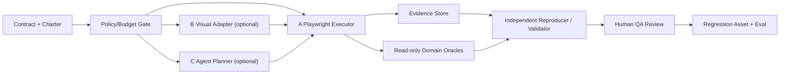

# 06｜测试架构与工具选型（避免重复执行栈）

## 层次划分

- **Domain & Contracts**：三业务规则、状态机和不变量。与 Agent/Browser 无依赖。
- **Fixture & Test Clock**：本地演示数据与故障注入，测试专用与生产配置隔离。
- **Executor**：推荐唯一主执行器 Playwright；CLI、MCP、Agent 只选择一种入口以免状态漂移。
- **Visual Adapter**：Midscene（可选），发现视觉线索；不能直接更改订单/授权/库存判定。
- **Agent Planner**：有预算的观察—假设—行动循环；不允许拿到管理 API 或高权限 Shell。
- **Oracle & Evidence**：只读业务事实 + Screenshot/Trace/动作记录/请求摘要。
- **Evaluation**：盲评、植入缺陷真值、成本、误报、安全事件和效益比较。

## 推荐选型

| 需求 | MVP 默认 | 备选/条件 |
|---|---|---|
| 本地确定性自动化 | Playwright Test | Selenium/Puppeteer 若现有技术栈已成熟 |
| Codex 浏览器探索 | Playwright CLI / 已授权 Host 浏览器工具 **二选一** | agent-browser CLI |
| 复杂视觉 UI | 不启用 | Midscene.js/Computer Use，在 P4 独立评估 |
| 自主任务执行 | 不启用 | Agentic Test Explorer/Browser Use/自建最小 Planner，在 P5 PoC |
| 网络/性能诊断 | Playwright Trace / request 日志 | Chrome DevTools MCP，仅排障路径 |
| 无障碍 | axe-core + 键盘人工评估 | 专项可访问性工具 |
| 秒杀并发 | API 受控并发测试 | k6（P2 完成并获得权限后） |

## 三个必须预防的架构错误

1. 不应将 Browser Tool 当成产品 Skill、Agent Runtime 或安全沙箱。
2. 不应将 CLI、MCP、Computer Use 共用真实个人 Chrome Profile；会话必须明确关联到 Run ID。
3. 不应为 MVP 强行支持所有浏览器 Provider；稳定的单一执行器 + 可替换接口足以支撑实验。

## ADR

第一期冻结 **ADR-0001**：Playwright 为确定性基线，Midscene 与 Agent 仅插件式实验。见 `docs/19-ADR-0001-测试执行架构.md`。
