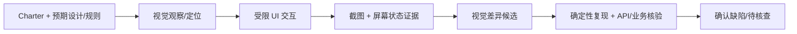

# 方案 B：视觉驱动的 UI 探索性测试

> 以 Midscene.js、受控 Computer Use 作为视觉观察与交互补充，以 Playwright / API / 后端状态作为独立验证。
> 核心问题：AI 看到的“界面异常”，怎样被证据证明为真实质量问题？

## 1. 为什么要加视觉层？

DOM/无障碍树非常适合稳定定位，但在复杂 Canvas、会员权益卡片、动画进度条、响应式布局、浮层和自定义图形控件上，用户看到的结果可能与 DOM 文本不同。

视觉驱动工具可以帮助观察：遮挡、溢出、颜色/层级错乱、图形异常、移动端可用性。Midscene.js 官方将截图视觉定位作为核心机制，并提供 `aiAct`、`aiQuery`、`aiAssert` 等能力；它不是所有业务规则的最终 Oracle。



## 2. 推荐工具组合及边界

| 模块 | 推荐 | 职责 | 不应承担 |
|---|---|---|---|
| 视觉探索 | Midscene.js | 看图定位、交互、文本/可见状态描述 | 金额/权限/库存最终裁决 |
| 特殊控件 | Computer Use（受支持宿主） | 系统弹窗、Canvas、跨界面观察 | 跨平台可移植 Runner 的稳定承诺 |
| 确定性执行 | Playwright Test | 固定输入和精确断言 | 视觉模型的语义猜测 |
| 诊断 | Chrome DevTools MCP | Console / Network / Performance | 自动证明服务端业务正确 |
| 无障碍检查 | axe-core + 人工 | 自动扫描与手工补充 | 完整替代键盘和读屏验证 |

Midscene 可结合 Playwright/JavaScript 测试；示例项目配置、模型 API、报表需按照锁定版本的官方指南设置。涉及模型调用时，应确认页面图像是否发送到外部服务。

## 3. 视觉探索的 Oracle 层次

1. **显式规则**：例如设计稿规定弹窗必须在可视区域内，移动端主 CTA 不能被遮挡。
2. **结构化 UI 证据**：节点可见、无遮挡、可操作区域合理；优先使用可检验的布局属性或截图比较基线。
3. **视觉模型判断**：AI 提出“看起来被遮挡”“文字难以阅读”，先记为候选问题。
4. **业务权威状态**：金额、等级、权益、库存、订单结果必须用明确契约和独立来源交叉验证。

避免把“模型觉得颜色不够醒目”直接等同于 Bug；有依据的可用性建议和违反规范的缺陷应分开登记。

## 4. 案例 E1：优惠券与下单的视觉探索

### 4.1 视觉任务

- 不同优惠券数量下，优惠券面板是否出现重叠或被屏幕底部遮挡？
- 合计从 100 降到 99 时，优惠金额、券的选中态、失效文案是否同步更新？
- 表单错误发生时，错误提示是否出现在用户可见区域？
- 320px、375px、768px、桌面宽屏下的“提交订单”按钮能否被访问？
- 金额格式、货币符号、折扣说明是否截断或有歧义？

### 4.2 探索步骤

```text
Given: 测试用户拥有 C20 券，购物车合计 100 元
Observe: 记录当前结算页屏幕状态、应付金额和券卡片
Act: 选择 C20 券，再把合计改为 99 元
Observe: 拍截图，检查金额/优惠券/提示视觉变化
Verify: 用只读价格计算 API 比对计算结果
Reproduce: 分别在桌面/移动视口执行，反复两次
```

### 4.3 可能得到的候选异常

- UI 显示“不可使用”，但仍标记为已选中。
- 优惠金额显示在屏幕外，用户误以为优惠已生效。
- 弹窗盖住提交按钮而未提供可见关闭方式。

验证时应区分**纯视觉表现问题**与**金额计算错误**；后者不能只凭屏幕截图定性。

## 5. 案例 M1：会员升级与降级的视觉探索

### 5.1 为什么适合视觉方案？

会员页往往有等级徽章、进度条、成长值、权益列表、升级特效和跨端不同设计。DOM 中可能有“金卡”文本，但页面仍展示了错误颜色或旧图标，用户很容易困惑。

### 5.2 探索任务

- 银卡升级金卡后，等级徽章、进度条、权益标签是否对应新等级？
- 金卡降至银卡后，旧等级专属卡片是否仍以“可使用”状态显示？
- 有效期到期前一天、到期当天、跨时区显示是否清楚？
- 显示“已降级”时，是否清楚说明哪些权益保留、哪些失效？
- 屏幕阅读器/键盘焦点能否触达等级说明与权益详情？

### 5.3 必须额外核对

如果视觉模型看到“金卡专属折扣”仍显示为可用，先检查规则：历史已领取券可能允许保留，但新下单特权可能已经撤销。然后调用权益校验 API 或只读事件账本；只有违反实际契约才可确认为 Bug。

建议同时抓取：降级事件时间、当前服务端等级、缓存过期时间、Web 截图、App 截图（如有授权）、权益判定接口结果。

## 6. 案例 S1：秒杀倒计时、排队与售罄视觉探索

### 6.1 视觉优势

- 复杂倒计时组件是否出现跳秒、负时间、遮挡。
- 排队遮罩是否阻止用户继续点击错误按钮。
- 页面响应式缩放时“立即抢购”是否变成不可见。
- 售罄文案和按钮状态有无冲突。
- 异步结果回填后，有无把失败提示覆盖成成功样式。

### 6.2 视觉不能证明的内容

看到“抢购成功”不证明订单已创建；看到“售罄”不证明库存已是 0。秒杀服务端时间不可通过 `Date.now()` 前端模拟替代。需要查询订单、库存和排队状态，必要时结合受限 k6 负载测试。

### 6.3 探索流程

```text
准备测试专用活动，设定可控开售时间
→ 浏览器观察活动前的按钮/倒计时
→ 推进服务端测试时钟或切换活动阶段
→ 观察活动中/排队/售罄三态
→ 记录屏幕和请求 ID
→ 由 API 查询权威状态
→ 将 UI 和后端不一致结果分类
```

对于排队流程，不能让 Agent 无界重试购买；应限定总动作和安全预算。

## 7. 可复用 Midscene YAML 思路

官方的 YAML Workflow 支持 `tasks`、`flow`、`aiAct`、`aiAssert`、`aiQuery` 等节点。下面仅给出**待适配的演示片段**，不是完整可直接运行的配置；初始化 Web Agent、模型 Provider、浏览器会话需要按所安装版本的官方指南补全。

```yaml
# 视觉校验示例：不含登录和数据构造，仅演示 flow 结构
# 须先导航到已准备好数据的会员页面
# 所有陈述均需和真实 UI 文案对应
tasks:
  - name: 会员降级后的视觉检查
    flow:
      - aiAssert: 页面有当前会员等级区域，等级文案清晰可见
      - aiQuery: 描述页面当前等级徽章与可用权益列表
        name: observed_membership
      - recordToReport: 会员降级后的可见状态
        content: 记录会员等级与权益展示，随后由服务端独立核实
```

特别注意：上面的 `aiAssert` 只是视觉可见性断言；要验证降级撤权，应该通过 Playwright/API 再做确定性断言。

## 8. 视觉探索提示词（可直接改造）

```text
你是有 UI 质量评审能力的 QA，目标是发现可复现的视觉/交互风险。
本次允许访问的只有 <staging-URL>，最多操作 20 步。
在三个场景中选择指定的一个：E1 优惠券 / M1 会员升降级 / S1 秒杀。
先说明当前可见状态，再提出不超过 5 个视觉风险假设。
每次操作后保存截图与步骤，记录视口尺寸和页面 URL。
只能依据屏幕说明观察结果，不能把视觉判断当作后台业务事实。
任何订单提交、权益修改、秒杀下单前必须获得明确授权。
若无法确认业务规则，写“待核查”，不要编造 Bug。
```

## 9. 视觉探索最容易误报的地方

| 现象 | 常见误判 | 补充证据 |
|---|---|---|
| 券标签灰色 | 一定不可用 | 设计规范 + 计算 API |
| 会员徽章未更新 | 后端等级升级失败 | 等级事件与缓存传播 SLA |
| 秒杀倒计时差一秒 | 计时逻辑错误 | 服务端时钟、采样时点、时钟同步 |
| 某按钮被遮盖 | 功能必然不可用 | 视口、焦点导航、点击命中测试 |
| 内容截断 | 必然严重 Bug | 设计规范、用户任务可完成性 |

## 10. TDD 与验收

- RED：先定义三个演示视觉失败样例，如弹窗遮挡、徽章/权益不一致、售罄按钮颜色/文案冲突，并准备精确的规则与图像证据。
- GREEN：让视觉流程能提出候选，并通过确定性方法验证；不能以模型一致认为“看起来正确”替代真实断言。
- REFACTOR：固化可重复的截图尺寸、字体、浏览器版本；将稳定 UI 不变量转成独立回归。
- 门禁：候选问题应有截图 + 上下文；业务结论有 API / 规则；误报记录可检索；所有动作处于授权范围。

## 11. 何时不值得使用 B？

- 页面结构稳定、DOM 定位方便、金额与状态可直接断言；
- 视觉模型调用成本高于新增覆盖价值；
- 模型需要上传不能外传的页面或敏感业务数据；
- 页面需要大量并发负载而非视觉交互；
- 团队没有可追踪的视觉基准和人工确认流程。

## 12. 参考资料

- https://github.com/web-infra-dev/midscene
- https://github.com/web-infra-dev/midscene/blob/main/apps/site/docs/en/automate-with-scripts-in-yaml.mdx
- https://github.com/ChromeDevTools/chrome-devtools-mcp
- https://github.com/dequelabs/axe-core
- https://playwright.dev/docs/visual-comparisons

> 三个案例与评估方法是 QA 工程建议；Midscene 的实际行为取决于模型、配置和版本。本文没有执行针对任何真实业务界面的视觉测试。
