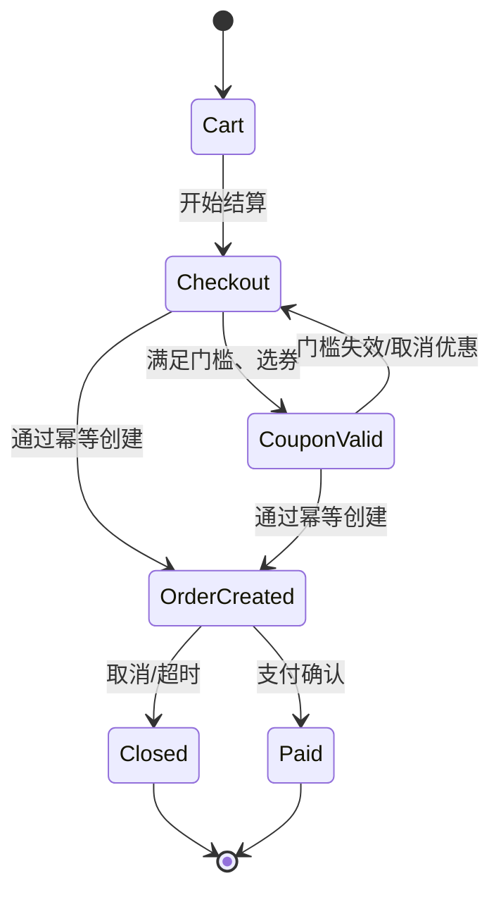
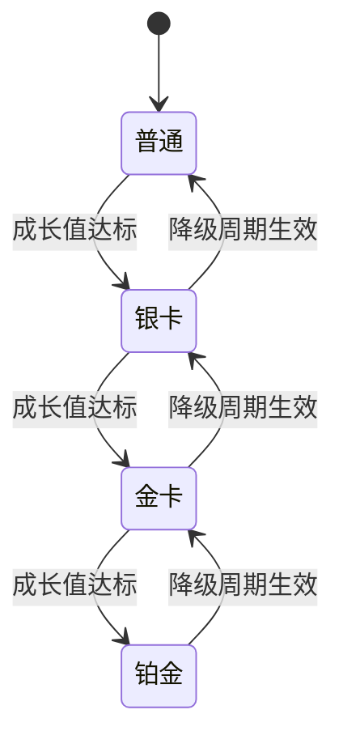
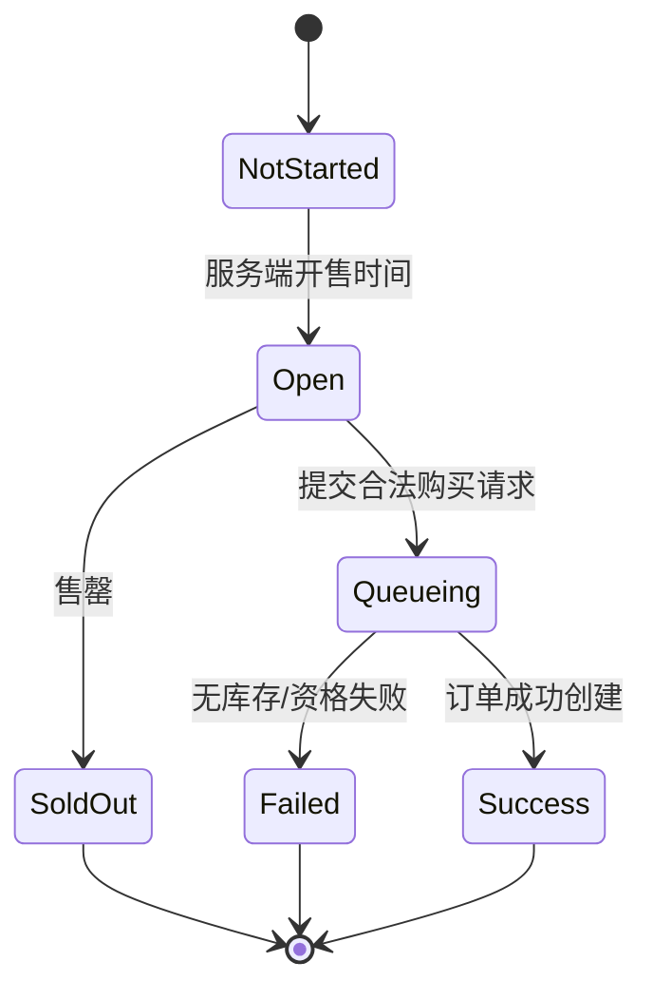

# 三案例测试设计矩阵（E1 / M1 / S1）

> 本文是三条技术路线共用的业务测试基础：**需求先行、状态驱动、业务 Oracle 独立于 AI**。
> 所有具体规则是教学假设，正式项目应标记来源需求 ID 并替换。

## 1. 统一前置模型

| 案例 | 业务实体 | 示例规则 | 权威真相源 | 主要风险 |
|---|---|---|---|---|
| E1 优惠券与下单 | Cart、Coupon、Order、Payment | 满100减20，每券按规则使用一次 | 价格计算、订单/券流水 | 金额错误、重复订单、券状态丢失 |
| M1 会员升降级 | Member、Tier、Entitlement、Event | 普通→银→金→铂，周期降级 | 会员事件账本、授权服务 | 降级越权、历史权益误删、缓存不同步 |
| S1 秒杀 | Campaign、SkuStock、Queue、Order | 100件、单账户限1件、10:00开售 | 服务端活动时钟、订单/库存流水 | 超卖、限购失效、排队错误 |

环境至少需要：可重复的数据种子、唯一测试用户、隔离环境、清理机制、只读验证接口、场景关联 ID。真实支付/真实会员权益/生产秒杀不得用于开放式探索。

## 2. E1：电商优惠券与下单

### 状态图（示意）



关键区别：哪些阶段占券、何时扣库存、支付失败如何回滚，真实系统规则未必相同。

### 用例集

| ID | 类型 | 步骤或条件 | 断言 / Oracle | 优先级 |
|---|---|---|---|---|
| E1-01 | 正向 | 100 元选 C20 | 应付 80；价格 API 一致 | P0 |
| E1-02 | 边界 | 99 元继续持有 C20 | 应付 99，不减免 | P0 |
| E1-03 | 状态 | 选券后刷新 / 返回 | UI 与草稿状态一致 | P1 |
| E1-04 | 幂等 | 重复点击创建订单 | 同一幂等请求最多一个有效订单 | P0 |
| E1-05 | 并发 | 两标签同时使用券 | 券核销遵循单次规则 | P0 |
| E1-06 | 恢复 | 支付 API 响应超时 | 不误报成功，最终订单可查询 | P0 |
| E1-07 | 异常 | 价格接口 500 | 显示明确错误，不可按旧金额提交 | P1 |
| E1-08 | 可访问性 | 仅键盘选券并提交沙盒订单 | 焦点与错误信息可访问 | P1 |
| E1-09 | 视觉 | 窄屏多个优惠券卡片 | CTA 和金额可见、无遮挡 | P1 |
| E1-10 | 历史 | 订单完成后券状态变化 | 历史订单金额不可被悄悄重算 | P0 |

### 重要不变量

```text
payable = subtotal - valid_discount + fees + taxes（以真实计价规则为准）
当优惠资格无效时，不得保留不符合规则的优惠抵扣
同一业务幂等键不能产生两笔有效重复订单
前端应付金额与服务端创建订单的结算金额符合契约
```

## 3. M1：会员升级与降级

### 状态与时间维度



**重点：降级后如何处置已领取权益并无通用答案。** 有的会员权益截止当期有效、有的立即失效、有的保留到券到期。必须先问需求，再编写测试预期。

### 组合覆盖维度

| 维度 | 值（示意） |
|---|---|
| 起始等级 | 普通 / 银 / 金 / 铂 |
| 变更类型 | 升级 / 续期 / 降级 / 手工调整 |
| 生效时间 | 即时 / 周期边界 / 延迟任务 |
| 会话 | 新登录 / 旧 Token / 多标签 / 多端 |
| 权益 | 新增可用 / 当前不再可用 / 历史已领取 |
| 故障 | 消息重复 / 消息乱序 / 缓存延迟 / 权益服务超时 |

覆盖时建议优先进行风险驱动 pairwise，再补最关键的全组合，不必在 PoC 中笛卡尔积全部执行。

### 用例集

| ID | 类型 | 步骤或条件 | 断言 / Oracle | 优先级 |
|---|---|---|---|---|
| M1-01 | 升级 | 银卡→金卡 | 等级、有效期、权益按规则生效 | P0 |
| M1-02 | 降级 | 金卡→银卡 | 当前等级与新购买资格正确 | P0 |
| M1-03 | 授权 | 使用降级前旧 Token 购买金卡专享 | 服务端按当前等级重新鉴权 | P0 |
| M1-04 | 历史 | 降级前领取的优惠券 | 按约定保留/失效，不任意清空 | P0 |
| M1-05 | 时间 | 周期到期的临界时间 | 服务端权威时间及有效期正确 | P0 |
| M1-06 | 幂等 | 重复消费降级事件 | 只发生一次有效状态变迁 | P0 |
| M1-07 | 乱序 | 升级/降级事件乱序到达 | 按版本和规则产生正确终态 | P0 |
| M1-08 | 缓存 | Web / App / 管理端展示不一致 | 在 SLA 内达到一致并有反馈 | P1 |
| M1-09 | 视觉 | 升级弹窗、权益卡、进度条 | 等级徽章与说明不冲突 | P1 |
| M1-10 | 审计 | 手工调整会员等级 | 操作有审计记录及授权 | P1 |

### 业务预言机

```text
entitled(user, resource, at_time)
 = 权威会员等级 + 权益生命周期 + 业务授权规则

UI 显示等级 != 当前授权是否生效
已领取权益 != 当前等级新购买资格
事件已接收 != 状态变更已经完成
```

## 4. S1：商品秒杀

### 状态图（示意）



**注意**：部分系统先创建占位订单、后支付；部分系统排队和预占库存解耦。测试不变量必须与真实架构匹配。

### 用例集

| ID | 测试层 | 场景 | 断言 / Oracle | 优先级 |
|---|---|---|---|---|
| S1-01 | UI+API | 早于开售 | 服务端不能提前成功售出 | P0 |
| S1-02 | UI | 开售状态转换 | UI 提示正确，倒计时无严重错误 | P1 |
| S1-03 | API | 单账号重复请求 | 最多一个有效成功购买（演示规则） | P0 |
| S1-04 | API+库存 | 100 件、超过 100 个合法竞争请求 | 有效售出件数不超过 100 | P0 |
| S1-05 | API | 非法资格 / 身份过期 | 正确拒绝，无库存副作用 | P0 |
| S1-06 | 状态 | 排队时刷新 / 退出 | 资格保留或失效符合规则 | P1 |
| S1-07 | 容错 | 请求超时但后台已创建订单 | 查询结果确定，不重复创建 | P0 |
| S1-08 | 异步 | 支付超时释放库存 | 库存守恒，补偿幂等 | P0 |
| S1-09 | 视觉 | 售罄按钮/提示、窄屏布局 | 状态和文案一致、按钮可用性合理 | P1 |
| S1-10 | 性能 | 可控流量波峰、队列积压 | SLO、错误预算、资源阈值满足目标 | P0 |

### 后端不变量（需要业务规则修正）

```text
有效成功订单累计商品数 <= 活动可供售出总量（演示为 100）
每账号成功购买件数 <= 活动限购量（演示为 1）
同一业务幂等键不能创建重复有效订单
退款/支付超时/预占释放必须满足库存账一致性
```

库存守恒公式要区分**已售、预占、可售、待释放及补偿**，不能简单使用“库存 = 总量 - 订单数”覆盖全部秒杀系统。

## 5. 三路线 × 三案例对照表

| 测试目标 | A：确定性执行 | B：视觉驱动 | C：自主探索 |
|---|---|---|---|
| E1 价格门槛 | DOM + 价格 API 精确断言 | 观察价格区/券状态冲突 | 生成边界和快速操作序列 |
| E1 重复订单 | 幂等 API/订单状态 | 重复点击时按钮反馈 | 发现异常提交流程；写操作受控 |
| M1 降级撤权 | 服务端授权 API | 权益卡是否显示过期/可用 | 旧会话、跨端、时间组合探索 |
| M1 等级 UI | 文字/节点断言 | 徽章、进度条、弹窗、响应式 | 更广的用户路径与状态切换 |
| S1 售罄 UI | 状态和 API 合同 | 按钮、倒计时、排队蒙层 | 探索刷新、断网、反复进入 |
| S1 库存不超卖 | **必须结合受控并发和只读库存账** | 不负责证明 | 仅提候选/分析，不能自行压测 |

## 6. 统一缺陷样例（虚构，仅作格式演示）

### E1-SUS-01：金额变化后券显示未更新

- 观察：99 元仍显示减 20，页面金额 79。
- 独立核对：价格 API 期望 99（如果契约明确）。
- 复现：恢复种子，重新执行 2 次。
- 分类：前端状态/计算异常候选。

### M1-SUS-01：降级后旧会话仍显示金卡权益

- 观察：旧标签页金卡卡片可点。
- 独立核对：服务端授权是否允许专享新购买。
- 分类：在授权接口未核对前**不应确认为越权漏洞**。

### S1-SUS-01：售罄页面仍出现成功提示

- 观察：UI 显示“成功”，后端库存可能为 0。
- 独立核对：订单状态、预占记录、库存流水、服务端时间与请求 ID。
- 分类：可能是异步状态延迟、错误提示或实际库存错误，需要进一步分析。

## 7. Evidence Matrix

| 证据 | E1 | M1 | S1 |
|---|---|---|---|
| 截图、浏览器 Trace | 必须 | 必须 | 必须 |
| 业务规则版本 | 必须 | 必须 | 必须 |
| 只读 API 状态 | 价格/订单/券 | 等级/权益 | 活动/订单/资格 |
| 后端账本摘要 | 订单和券流水 | 等级事件、授权审计 | 库存、订单、补偿流水 |
| 时间字段 | 结算/回调时间 | 等级生效时间 | 活动时钟/队列时间 |
| 数据重置记录 | 购物车、券、测试订单 | 等级事件、权益 | 活动、库存、订单 |

## 8. 退出条件

- 所有 P0 不变量已映射到自动化或可复核的手工证据。
- 可复现问题均有独立 Oracle 或被标记为待核查。
- 没有未经授权的真实交易、会员修改和负载压测。
- 三类场景中的异常及正常样本均被覆盖，而不是只测失败/只测成功。
- 每条确认为缺陷的发现至少能关联一个持续回归资产或明确的不纳入理由。
