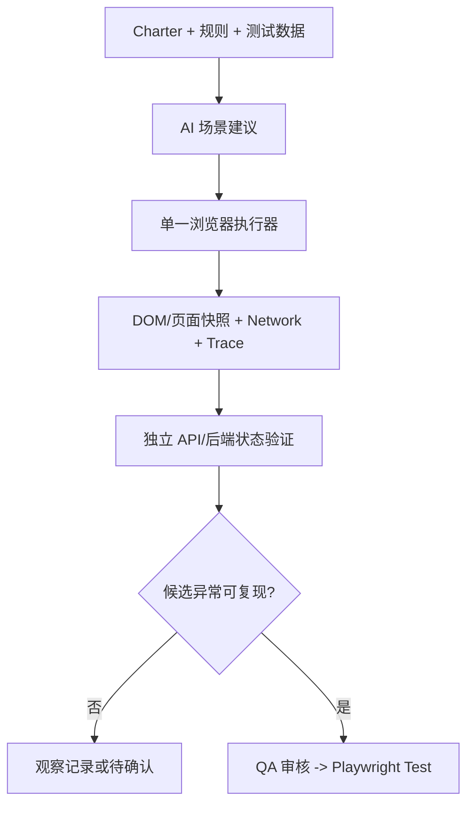

> **历史长文草稿，当前未重新实测。发布前需重新核验工具版本、安装方法和业务证据。**

# 方案 A：确定性浏览器执行与证据驱动探索

> 适用：初次把 AI 引入 UI 测试、已经使用 Playwright、希望低成本稳定复现的 QA 团队。
> 路线：Playwright CLI 或 agent-browser（主执行器二选一） + Playwright Test + 业务独立验证器。

## 1. 目标和非目标

**目标**：让 AI 基于明确 Charter 执行页面操作，及时保存截图、快照、Network/Trace，把可信问题转换成稳定回归。

**非目标**：不建立新的通用 Agent Runtime；不依赖 LLM 自评订单、权益、库存的最终正确性；不将 CLI 权限当作操作授权；不做未经批准的生产交易。



## 2. 安装与启动

官方 Playwright CLI 文档提供：

```bash
npm install -g @playwright/cli@latest
playwright-cli --help
playwright-cli install --skills
# 以下地址仅用于展示命令，不涉及业务数据
playwright-cli open https://demo.playwright.dev/todomvc/ --headed
playwright-cli snapshot
playwright-cli screenshot
playwright-cli requests
playwright-cli console
playwright-cli close
```

`playwright-cli` 支持命名 Session、快照、截图、请求、Console、Trace 等能力；动作是否会产生业务副作用仍需由执行宿主限制。

如改用 `agent-browser`，应独立配置 `--allowed-domains`、`--action-policy` 等限制；但它们不能替代主机、网络和账号层面的权限隔离。

> 生产工程建议固定可用版本、记录工具/模型版本、使用专属低权限账号；示例中的 CLI 命令均来自对应官方 README，不表示本文已运行这些命令。

## 3. 通用测试契约

- 输入：`charter_id`、环境 URL、版本/commit、账号角色、禁止动作、业务规则链接、固定数据集。
- 操作：最多 N 步；每个破坏性动作需独立审批；禁止外部域名跳转、真实支付、批量写入。
- 验证：页面证据不能代替服务端权威状态。必须定义每条测试的 Oracle。
- 输出：`run_id`、case_id、测试数据 ID、截图、Trace、Network 摘要、Oracle 响应、结论与不确定性。
- 失败恢复：只允许重试幂等动作；对订单和秒杀请求先查询最终状态再决定是否重试。

## 4. 案例 E1：优惠券与下单

**教学规则**：满 100 减 20；金额不满足门槛后应移除减免；同券不可在两笔违反规则的订单中核销。

### 测试数据

- `user_e1`：已登录，拥有未使用优惠券 `C20`。
- 商品 A：单价 50 元；商品 B：单价 49 元。
- 先加入 A × 2，后改为 A × 1 + B × 1；恰好从 100 降到 99。
- 测试后清理订单、恢复优惠券、恢复测试库存。

### 必测场景

| ID | 探索动作 | 页面预期 | 独立 Oracle |
|---|---|---|---|
| E1-01 | 合计 100，选择 C20 | 减免 20，应付 80 | 价格计算 API 返回 80 |
| E1-02 | 改为合计 99 | 优惠不再适用 | 价格计算 API/订单草稿不减 20 |
| E1-03 | 选择券后刷新 | 结算状态符合规则 | 后端草稿和页面一致 |
| E1-04 | 双击提交订单 | 不产生重复成功订单 | 按业务幂等键/业务订单号检索 |
| E1-05 | 模拟接口超时 | 不误报支付成功 | 订单最终状态与回调记录 |

### 示例 Playwright Test 模板

下面是**待适配的可执行测试骨架**：选择器、数据准备 API、接口返回结构依赖具体项目。没有真实环境时不能直接宣称通过。

```typescript
import { test, expect } from '@playwright/test';

test('E1-02: 99 元不可继续使用满 100 减 20 券', async ({ page, request }) => {
  // 实际项目应以受控 fixture / test-only API 准备隔离数据。
  await page.goto(process.env.STAGING_CHECKOUT_URL!);
  // 以下 test id 是演示约定，需要由产品提供或替换。
  await page.getByTestId('coupon-C20').click();
  await page.getByTestId('item-A-quantity').fill('1');
  await page.getByTestId('item-B-quantity').fill('1');
  await expect(page.getByTestId('subtotal')).toHaveText('¥99.00');
  await expect(page.getByTestId('discount')).toHaveText('¥0.00');
  const res = await request.get(`${process.env.TEST_READONLY_API}/checkout/current`);
  expect(res.ok()).toBeTruthy();
  const state = await res.json();
  expect(state.payableCents).toBe(9900);
  expect(state.appliedCouponId).toBeNull();
});
```

### 高风险提醒

`double click` 测试不能证明全链路没有重复订单；需验证服务端幂等与真实订单状态。测试调用不得触发真实支付。

## 5. 案例 M1：会员等级升级与降级

**教学状态**：普通 → 银卡 → 金卡 → 铂金；降级按周期/人工事件触发，权益生效时间必须依据 PRD。

### 测试数据

- `user_m1`: 银卡起始，测试专用管理 API 可推进成长值或模拟等级事件。
- 另准备金卡用户与带旧 Token 的登录会话。
- 后端权益服务提供只读授权查询接口；测试身份不得拥有修改真实会员权益的权限。

### 必测场景

| ID | 探索动作 | 独立 Oracle | 风险 |
|---|---|---|---|
| M1-01 | 银卡升级金卡后刷新权益页 | 会员事件 + 权益服务状态 | 页面升级成功但权益未生效 |
| M1-02 | 金卡降银卡，保持旧标签页 | 购买 API 重新鉴权 | 旧页面仍能使用金卡专享能力 |
| M1-03 | 降级后使用旧 Token | 服务端权限拒绝/重新计算 | 鉴权缓存错误 |
| M1-04 | 定时降级任务重复执行 | 事件幂等 / 最终等级 | 反复降级或重复扣权益 |
| M1-05 | 跨端对比 Web 与 App | 权威等级 + 允许的缓存传播 SLA | 不一致且超出容忍窗口 |

### 状态机断言

```text
Given: user_m1 已被权威会员服务确认降至银卡
When: 使用降级前登录的旧浏览器会话访问金卡专属购买 API
Then: 服务端按当前有效权益拒绝；不会产生专属权益消费流水
And: 会员页面在约定缓存期限内更新等级标签
```

核心重点：不要只看“金卡按钮隐藏了”就判定安全，必须验证服务端授权。

## 6. 案例 S1：商品秒杀

**教学规则**：库存 100、每账号限购 1、10:00 开始。真正时间由服务端权威控制。

### 可由浏览器稳定覆盖

- 活动前/活动中/已结束的倒计时和按钮状态。
- 重复点击后按钮禁用与提示行为。
- 排队过程刷新时状态恢复（如果业务规则允许）。
- 资格不足时页面提示与拒绝结果。
- 售罄后展示与订单结果的基本一致性。

### 不能只靠浏览器覆盖

- 不超卖、同账号限购、跨账号并发、库存扣减原子性。
- 支付超时库存释放、消息重放与最终一致性。
- 高峰吞吐、锁竞争、队列积压、服务降级。

这些必须由服务/API 并发压测与只读状态验证补充。k6 可以用不同 executor 模拟到达率/虚拟用户，但必须限定测试环境、流量预算和测试数据。

### S1 案例断言

```text
S1-01：活动开始前，服务端拒绝提前下单；UI 不得误报成功
S1-02：单账号多次提交，成功订单数 <= 1（业务规则下）
S1-03：受控并发后，有效成交总件数 <= 100
S1-04：已确认库存为 0 时，成功创建订单的数量不再增加
S1-05：排队/超时后，最终订单结果可查，不允许未知状态无界重试
```

UI 是观察面；S1-03 和 S1-04 必须以真实订单/库存后台证据验收。

## 7. Trace / Network / 业务证据采集

最小证据包（每个候选问题）：

```text
run_id/
  charter.md
  environment.json          # 版本、测试环境、数据种子
  steps.md                  # 时间线与实际动作
  screenshots/              # 已脱敏截图
  browser.trace.zip         # 如果执行器已生成
  network-summary.json      # 已脱敏、仅必要字段
  oracle.json               # 只读后端核验的摘要
  finding.md                # 观察/怀疑/复现/确认
```

建议对重要文件计算 SHA-256，对缺陷 ID 与测试环境版本建立追踪。Trace 可使用 Playwright 官方 Trace Viewer 复核，不得将真实 Cookie/Token 上传第三方。

## 8. TDD 质量门禁

1. `RED`：针对 E1 金额门槛、M1 降级撤权、S1 资格拒绝先编写失败的断言。
2. `GREEN`：只允许通过真实修复或合理测试夹具让测试通过；禁止绕过业务断言。
3. `REFACTOR`：稳定定位器、隔离数据准备、复用只读 Oracle，不改变预期语义。
4. 回归门禁：业务 P0 必须通过；高风险异步路径有一致性证据；失败应保存 Trace；不能以重试后通过隐瞒 flaky 状态。
5. 独立安全门禁：账号、域名、Shell 和写操作权限单独审查。

## 9. MVP 的推荐交付物

- 3 份 Charter、每例至少 5 条代表性探索任务。
- 1 个主执行器、3 套数据准备/恢复逻辑。
- 统一 Evidence 结构和缺陷模板。
- 至少 1 条每例的稳定 Playwright 回归测试。
- 真实执行报告：成功/失败、证据完整性、复现率、误报和成本。

## 10. 参考

- https://github.com/microsoft/playwright-cli
- https://playwright.dev/docs/test-agents
- https://playwright.dev/docs/trace-viewer
- https://playwright.dev/docs/network
- https://github.com/vercel-labs/agent-browser
- https://grafana.com/docs/k6/latest/using-k6/scenarios/

> 公开工具能力已按官方仓库/文档核对；这里的服务端测试接口、业务不变量和测试数据为 QA 实施建议，并非工具自带功能。
