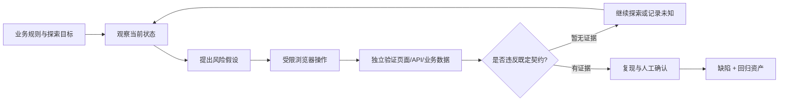
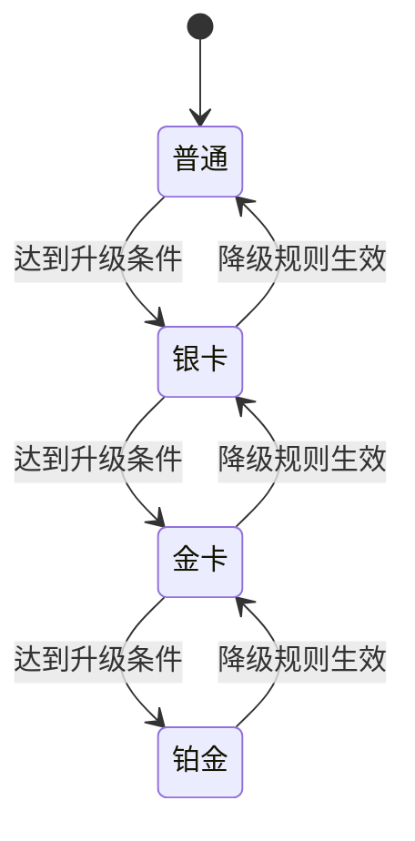
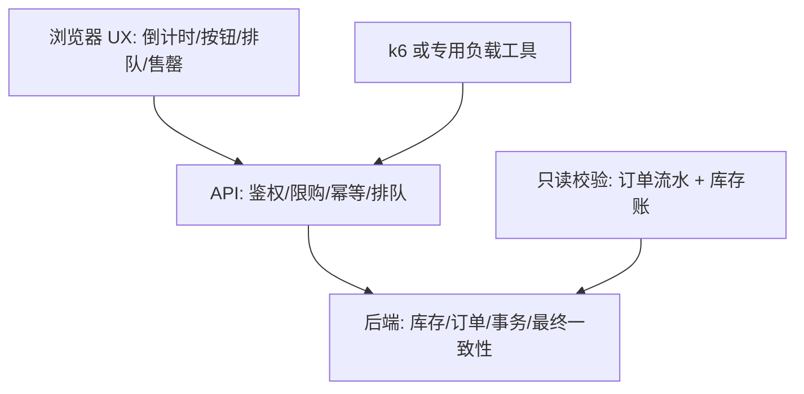

> **历史长文草稿，当前未重新实测。发布前需重新核验工具版本、安装方法和业务证据。**

---
title: "AI 已经会操作浏览器了，为什么 UI 探索性测试仍然需要 QA？——三个业务案例讲透三种技术路线"
date: 2026-11-23
tags: [AI测试, 探索性测试, Playwright, Browser Agent, 质量工程]
description: "从电商优惠券下单、会员升降级、商品秒杀三个案例出发，比较确定性执行、视觉驱动探索与自主 Agent 探索，建立证据驱动的 UI 测试方法。"
---

# AI 已经会操作浏览器了，为什么 UI 探索性测试仍然需要 QA？

> 三个业务案例讲透三种技术路线：Playwright / agent-browser、Midscene / Computer Use、自主 Browser Agent
>
> 适合刚接触 AI 测试的 QA、已有自动化经验的测试工程师，以及正在建设 AI-Native QA 工具链的团队。

## 目录

1. AI 浏览器测试发展到了哪一步？
2. 浏览器自动化和探索性测试，有什么不同？
3. 为什么选择三个业务案例？
4. 三类浏览器测试方案与工具地图
5. 案例一：电商优惠券与下单
6. 案例二：会员等级升级与降级
7. 案例三：商品秒杀
8. 如何让 AI 真正发现 Bug，而不是只会点击？
9. 三种实施路线与组合建议
10. 风险、安全边界与常见误区
11. 结果如何评估？
12. 新手最佳实践、FAQ、参考资料

---

## 一、AI 浏览器测试发展到了哪一步？

过去，测试同学想验证网页，常用 Playwright、Selenium 或 Cypress 编写脚本，提前指定元素、步骤和断言。今天，Coding Agent 借助 CLI、MCP 或 Computer Use，已经可以读取页面快照、截图、控制浏览器，并根据反馈继续操作。

例如，我们可以说：

> 打开隔离测试环境，使用指定测试账号登录，找到优惠券入口，尝试使用一张满减券；每完成一步观察页面变化，遇到异常先记录证据，不要执行真实支付。

AI 可能完成导航、点击、输入与截图。但**能操作网页，不等于能发现真实业务缺陷**：它不知道优惠券规则是否有特例，也未必知道用户升级会员后哪些权益应立即生效，更不能通过多点几次按钮证明秒杀不会超卖。

更成熟的目标是形成这样的质量循环：

这套流程中，“做动作”只是其中一段。测试设计、预言机（Oracle）、状态准备、独立验证和复现才决定了探索是否可靠。

## 二、探索性测试不是随机点击

探索性测试强调在测试的同时学习系统、设计下一步测试，并判断观察到的行为是否合理。

- **执行能力**：能否进入页面、找到控件并完成操作。
- **探索能力**：能否根据刚看到的状态提出有价值的下一个问题。
- **判断能力**：能否用需求、契约、不变量或可信后台证据支持结论。
- **恢复能力**：会话过期、元素消失、接口失败后能否重新建立可测状态。
- **治理能力**：能否遵守测试范围和副作用限制，并保留可追踪证据。

普通 UI 自动化验证已知路径；探索性测试重点学习和挑战未知路径。它们相互补充：探索发现高价值场景，再沉淀为可重复的确定性回归。

## 三、为什么需要三个业务案例？

仅用“电商下单”讲 AI 测试，很容易得出“AI 点击成功=测试有效”的错误印象。这里选取三个结构不同的业务案例：

| 编号 | 业务 | 状态特征 | 核心测试难点 | 最重要的独立证据 |
|---|---|---|---|---|
| E1 | 优惠券与下单 | 金额、优惠资格、订单状态随操作变化 | 价格计算、重复提交、异步回调 | 订单快照、价格计算接口、交易状态 |
| M1 | 会员升降级 | 等级与权益是跨时间的状态机 | 生效时间、延迟任务、权限撤销、跨端缓存 | 会员等级事件、权益授权记录、服务端校验 |
| S1 | 商品秒杀 | 时间窗口、库存竞争和高并发 | 超卖、限购、资格、排队、超时恢复 | 库存流水、订单唯一性、服务端事务与压力指标 |

**演示业务规则**：E1 采用满 100 减 20；M1 采用普通 / 银卡 / 金卡 / 铂金四级；S1 假设 100 件库存、每账号限购 1 件。以上均为教学假设，必须用实际 PRD 替换。

## 四、把工具按职责分类，而不是看谁的演示最炫

### 4.1 确定性浏览器执行工具

- **Playwright CLI**：通过 CLI 执行导航、页面快照、交互、截图、请求和 Trace，适合 Coding Agent 与已有 Playwright 体系。官方安装方式：`npm install -g @playwright/cli@latest`。
- **Playwright MCP**：通过 MCP 暴露浏览器能力，适合已具备 MCP Host 的团队。MCP Server 不是安全边界，代码执行等高权限能力须隔离或限制。
- **Vercel agent-browser**：适合 Agent 使用的 CLI，包含快照、元素引用、网络观察、动作策略与域名限制等能力。域名限制不等于 OS 层网络防火墙。
- **Selenium / Puppeteer**：依然适合作为成熟执行栈；它们不是天然的“测试判断 Agent”。

### 4.2 视觉理解与智能交互工具

- **Midscene.js**：以截图视觉定位作为主要能力，支持 `aiAct`、`aiQuery`、`aiAssert` 等操作，适合复杂组件、Canvas、视觉布局和 UI 断言。模型判断需要结合独立结果验证。
- **Computer Use**：直接观察与操作屏幕，对纯视觉交互有价值；具体能力依赖宿主，不应直接当作通用可移植 Runtime。
- **Stagehand**：将 `act`、`observe`、`extract` 等原语组合，适合动态界面和半确定性操作。
- **Browser Use / Skyvern**：更偏任务级 Agent，适合研究跨步骤目标、恢复行为和模型自主决策；需核对版本、许可、数据流与执行权限。

### 4.3 面向测试、诊断与评估的能力

- **Playwright Test Agents**：官方提供 planner / generator / healer，可把计划转成 Playwright Test。Healer 不能被授权自行修改业务断言以掩盖真实 Bug。
- **Agentic Test Explorer**：开源探索性测试 PoC，公开描述基于任务 Mission、不同测试角色、Playwright 操作及复现脚本输出；它的实际缺陷发现效果仍需本地实测。
- **Chrome DevTools MCP**：辅助 Network、Console、Performance 和调试证据。
- **axe-core**：可访问性自动检查辅助工具，不能代替人工完整评估。
- **BrowserGym / AgentLab**：研究和评估环境，不是生产业务的浏览器执行器。
- **k6**：用于并发和负载模型；秒杀业务不能仅靠浏览器 Agent 测并发正确性。

工具选择原则：**只选择一个主要执行器，给视觉工具和诊断工具明确边界，先验证可复现性，再追求自动化程度。**

## 五、案例一：电商优惠券与下单（E1）

### 5.1 假设需求

商品合计达到 100 元可使用一张满减 20 元券；订单提交前如商品金额跌破门槛，优惠应重新计算；一张券不能在不符合规则的两笔订单中同时核销；支付失败后的券恢复逻辑以真实产品规则为准。

### 5.2 人工 QA 会怎样探索？

最开始可能是“加购—选券—结算”。随后继续挑战：

1. 选择满减券后，把商品数量减少到 99 元，金额是否自动重算？
2. 结算时刷新、返回、重新进入，优惠状态是否保持一致？
3. 连续点击提交订单，是否产生两笔订单？
4. 两个标签页同时尝试同一张券，最终是否只能按规则核销一次？
5. 网络超时、第三方支付回调重复、取消订单后，订单、券和库存是否一致？

### 5.3 三种方案怎么做？

| 方案 | 典型做法 | 能发现什么 | 还缺什么 |
|---|---|---|---|
| A 确定性 | Playwright 操作 + API 断言 | 金额不一致、重复提交、状态错误 | 后台订单/券状态的独立验证 |
| B 视觉 | Midscene 对比价格卡片、券选中状态、移动端布局 | 文案覆盖、价格区显示错位、弹窗遮挡 | 精确金额仍需结构化数据校验 |
| C Agent | 根据异常状态自主决定继续刷新、取消、重进 | 更多组合路径和意料之外的操作序列 | 重复复现和业务 Oracle 不能只由 Agent 自评 |

### 5.4 怎样确认 Bug？

假设页面显示应付 79 元，订单详情却显示 99 元。此时先保存截图、Network 和订单 ID，再检查服务端计算结果：到底是页面显示过期、订单创建计算错，还是优惠契约本就允许不同结算阶段的显示差异？**现象是线索，违反明确业务规则才是缺陷。**

## 六、案例二：会员等级升级与降级（M1）

这类功能比一次性下单更适合说明 AI 探索的价值，因为它包含**时间和状态变更**。

### 6.1 假设需求

演示等级为普通、银卡、金卡、铂金：

- 用户累计成长值达到阈值可以升级；阈值由真实产品配置提供。
- 升级后新权益按规则生效；降级可能发生在周期结束或人工调整时。
- 降级后新购买不能继续享有不属于当前等级的专属权益。
- 历史已完成订单的价格、合法已领取权益是否保留，**必须依据业务规则**；不能笼统认为降级后全部消失。

### 6.2 推荐状态机

并非所有系统允许越级升级、立即降级、手工降级；以上状态机是教学示例。

### 6.3 重点探索四组场景

**升级正确性**：从银卡变金卡后，会员页面显示金卡，但支付结算是否真的获得金卡折扣？升级通知、有效期、历史订单是否正确？

**降级正确性**：金卡降为银卡后，旧 Token、旧页面缓存、旧标签页是否仍可使用“金卡专属购买资格”？尤其要验证**后端授权**，而不是只看按钮是否隐藏。

**时间边界**：周期到期前后、定时任务重复执行、跨时区、升级与降级事件几乎同时到达时，等级状态是否一致？

**跨端一致性**：Web 显示银卡，App 显示金卡，客服后台显示不同等级时，究竟哪个是权威数据源？允许的缓存延迟是多少？

### 6.4 一个容易发生的真实类型风险

页面上已经从金卡变成银卡，但用户在不刷新页面的情况下仍能点击金卡专属商品购买按钮。

这不是立即可以确认的越权 Bug：**按钮可点**和**服务端实际允许成交**是两件事。必须核对交易 API 的授权结果，以及最终权益使用流水。

### 6.5 三方案分工

- A：用测试数据接口准备等级、推进业务时钟，验证状态变迁、服务端权益、历史订单不变量。
- B：观察等级标签、权益卡片、进度条、升级弹窗及移动端布局，并提示状态展示冲突。
- C：扮演新会员、老会员、反复切换页面的用户，探索跨端/过期会话/升级—降级组合路径，再由确定性验证器复核。

## 七、案例三：商品秒杀（S1）

这个案例可以帮助大家识别 AI 浏览器工具的边界。

### 7.1 假设需求

演示活动：10:00 开始，库存 100 件，每个账号最多成功购买 1 件。未到开始时间不可成交；售罄后不再接收成功订单；支付超时是否释放库存，按真实产品契约确定。

### 7.2 三层需要分别验证

**浏览器层**可验证倒计时、活动按钮、重复点击提示、排队状态、成功/失败页面、售罄时提示。

**接口与服务层**才能更可靠地验证同账号限购、去重、资格校验、接口重试、超时补偿。

**并发与一致性层**需在可控环境使用 k6 等工具产生有边界的负载，并检查最终不变量。例如演示中的成功售出量不得超过 100；活动结束后库存与有效成交之间满足预定账务规则。

注意：浏览器模拟时间不等于改变后端权威活动时间。真正的边界测试通常需要测试专用时间控制或活动数据配置。

### 7.3 典型探索问题

- 倒计时刚结束，多个标签页的按钮状态一致吗？
- 点击一次后按钮还可以重复提交吗？
- 排队过程中刷新，原排队资格是否保留？
- 已售罄但界面还显示“可购买”，这属于缓存延迟还是已违反明确的体验要求？
- 用户界面显示购买成功，后端最终是否有对应订单与库存扣减？
- 发生超时时，订单状态为未知，系统能否安全重试而不重复成功？

### 7.4 三方案分工

- A：稳定检查时间状态、按钮反馈、订单创建与接口契约。
- B：识别倒计时重叠、排队蒙层、移动端按钮不可见等 UI 问题。
- C：自主探索刷新、切标签、断网恢复等序列，**不得自行发起无界并发攻击或绕过限购**。

对秒杀，**自主浏览器 Agent 找到异常只是起点，后端事务与负载证据才是判断超卖的关键。**

## 八、AI 发现的问题如何变成可信 Bug？

建议明确四种状态：

| 状态 | 定义 | 能否直接作为已确认 Bug |
|---|---|---|
| Observation | 记录到客观页面或接口现象 | 否 |
| Suspected Issue | 有合理怀疑，缺少规则或证据 | 否 |
| Reproduced Issue | 可用相同条件重复触发 | 待人工核对 |
| Confirmed Defect | 有业务契约/不变量和独立证据支持 | 可以 |

三个案例都有各自的 **Oracle**：E1 看价格/券/订单，M1 看服务端等级与权益授权，S1 看库存/限购/订单唯一性。

一份最小缺陷报告应该包含：场景 ID、环境与版本、准备数据、探索步骤、关键动作时间线、预期依据、实际结果、独立证据、复现次数、影响范围、人工确认状态。

Playwright Trace 可记录操作、DOM 快照和请求等信息；对于复杂问题再补 Chrome DevTools MCP 诊断。敏感 Token、Cookie、支付信息需要脱敏。

## 九、三条可落地路线

### A：确定性执行与证据（默认起点）

`QA 任务 → Playwright CLI/agent-browser → 页面操作 → API/状态断言 → Trace → 人工确认`。

适用于：基础交互稳定、团队已有自动化、需要可重复回归的情形。建议先从 E1 下单和 M1 降级权限验证开始。

### B：视觉驱动 UI 探索（复杂页面补强）

`视觉观察 → Midscene/Computer Use 执行 → 截图对比/异常识别 → Playwright/API 独立复核`。

适用于：Canvas、响应式布局、自定义会员卡、秒杀倒计时、弹窗遮挡。**视觉模型并不是业务金额或权益的最终 Oracle**。

### C：自主 Agent 探索（受限 PoC）

`Charter → Planner → Executor → Evidence → Independent Verifier → Human Review → Regression`。

适用于：需要探索未知状态组合，并希望比较 Agent 策略的团队。执行应有预算、最大步数、允许域名、动作审批和恢复策略。

三者可组合，但 MVP 不需要同时安装三套执行器，更不需要一开始就建设多 Agent 编排平台。

## 十、风险与误区

1. **会点击 ≠ 会测试**：AI 只是执行浏览器动作，并不天然理解业务契约。
2. **截图显示成功 ≠ 服务端正确**：升级会员后旧权限是否撤销、秒杀订单是否真实入账，需要后台证据。
3. **视觉识别 ≠ 完整可访问性测试**：仍需键盘、屏幕阅读器、axe-core 等工具及人工检查。
4. **高并发 ≠ 频繁点击**：真正的秒杀并发验证需要独立流量模型与数据校验。
5. **模型自我评价 ≠ 独立证据**：Agent 不应既提出缺陷又独自裁定缺陷真实性。
6. **域名白名单 ≠ 隔离**：还需限制 Shell、文件、任意 JS、网络出口、权限和真实账号。
7. **Healer 让测试通过 ≠ 产品通过**：不允许在无人审核的情况下改写业务断言。
8. **安全和合规**：仅在获得明确授权的非生产或隔离环境内执行有副作用探索。

## 十一、如何评价 AI 的真实价值？

不应只比较“发现了多少个 Bug”。建议统一比较：

- 有效缺陷数量及 Precision（有效缺陷 / 提交候选数）。
- 已植入缺陷集合上的 Recall（发现的已知缺陷 / 总植入缺陷）。
- 独立复现率、证据完整率、探索覆盖率。
- 每个有效 Bug 的总成本（模型费用 + 机器资源 + 人工确认时间）。
- 安全违规次数、越权动作拦截率。
- 回归测试沉淀率与重复执行稳定性。

可以用 E1、M1、S1 三组同条件 Demo，分别让人工 QA、A、B、C 路线执行多轮对照测试。每组固定缺陷集、时间预算、测试账号和独立确认标准，避免只挑选成功案例。

## 十二、新手最佳实践与 FAQ

**最佳实践**：先写 Charter；先准备可重置的测试数据；清楚列出禁止动作；每次操作只记录新观察；重要结论必须有后端/接口/契约证据；Bug 必须重复复现；确认后将高价值场景转成自动化回归；对 Agent 的错误和越权尝试同样留证。

**Q：不会写代码可以开始吗？** 可以。先用受限测试环境、Playwright CLI 或浏览器 Agent 做观察和探索；但判断 Bug 必须理解测试设计和业务规则。

**Q：视觉工具可以替代 DOM 自动化吗？** 不完全可以。对视觉困难的页面有优势，但语义稳定、业务计算精确的场景通常仍适合确定性断言。

**Q：秒杀只测 UI 就够了吗？** 不够。秒杀的核心是时间、并发、库存和事务一致性，需要 API 和后端层证据。

**Q：Agentic Test Explorer 能直接用于生产吗？** 它公开定位为 PoC / 探索框架；需要额外评估许可、隔离、遥测、权限和实际结果，不能直接承诺生产安全。

**Q：AI 是否能代替 QA？** 它可以提高页面观察、路径执行和测试场景扩展的效率，但业务风险建模、判断依据、残余风险和发布决策仍需要明确的人类责任。

## 结语

电商下单验证的是**价格和交易一致性**，会员升降级验证的是**状态、权限与时间一致性**，商品秒杀验证的是**并发与资源一致性**。这三个案例说明：不是 Agent 能点多少按钮决定测试价值，而是它是否能找到值得验证的风险，并提供让团队信服的证据。

**AI 浏览器探索性测试的目标，不是让 AI 替我们随机操作，而是让 QA 拥有更强的观察、探索、复现和风险验证能力。**

---

## 参考资料

- [Playwright CLI](https://github.com/microsoft/playwright-cli)
- [Playwright Test Agents](https://playwright.dev/docs/test-agents)
- [Playwright Trace Viewer](https://playwright.dev/docs/trace-viewer)
- [agent-browser](https://github.com/vercel-labs/agent-browser)
- [Midscene.js](https://github.com/web-infra-dev/midscene)
- [Agentic Test Explorer](https://github.com/srbarrios/agentic-test-explorer)
- [Chrome DevTools MCP](https://github.com/ChromeDevTools/chrome-devtools-mcp)
- [Browser Use](https://github.com/browser-use/browser-use)
- [Stagehand](https://github.com/browserbase/stagehand)
- [BrowserGym](https://github.com/ServiceNow/BrowserGym)
- [axe-core](https://github.com/dequelabs/axe-core)
- [k6 场景模型](https://grafana.com/docs/k6/latest/using-k6/scenarios/)

> 注：本文工具能力据所列项目官方资料整理（核验于 2026-11-23）。三个业务模型为教学示例；未声称在真实业务中执行或发现缺陷。工具原生支持的功能与本文提出的工程组合方案应区别理解。
