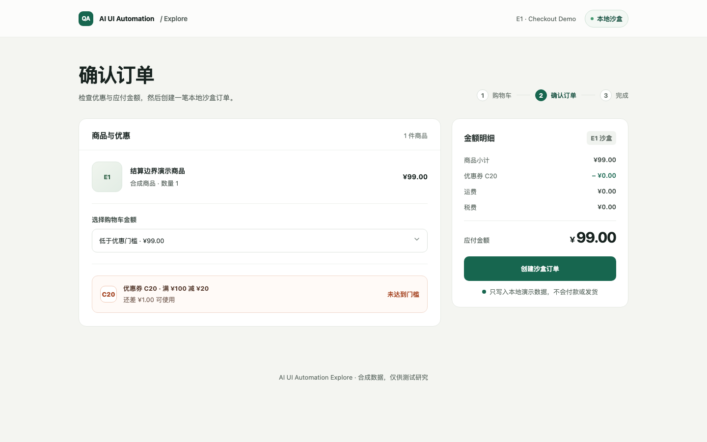
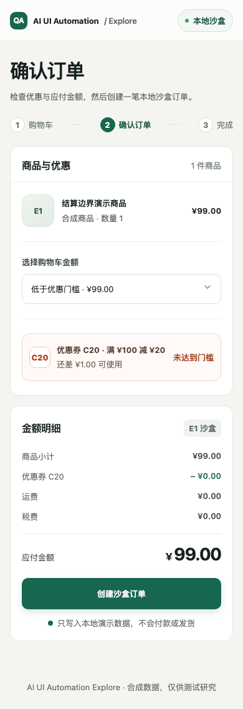

> **写作状态：实战草稿，尚未完成逐条技术与编辑 Review。** 项目记录了 Playwright Test 1.65.1 的本地浏览器回归、Oracle 对照和 CI 运行；安装方式、跨浏览器能力、POM 与模型探索仍有未验证项。本文不代表 Playwright Test 自动发现了业务缺陷。

# Playwright Test 实战：从浏览器操作到可维护的 UI 自动化测试

如果结算页显示“优惠已用”但服务端报价没有减免，单看页面截图很难判断是哪一层出了问题。Playwright Test 可以把浏览器操作写成重复运行的测试，再用应用提供的 API 或只读账本核对业务结果。它负责执行和断言；测试人员仍要定义该检查什么、由什么权威数据证明。

本文用本仓库的 E1 优惠券案例说明一条实际回归路径：固定 99 元购物车、选择 C20、记录页面报价，再用同一 Run 和 quote ID 查询独立 Oracle。所有界面截图来自本地合成 Demo；受控故障只改过 UI 展示逻辑，不改服务端 Oracle，也没有真实支付或发货。

## Playwright Test 是什么

Playwright Test 是浏览器端到端测试框架，包含 Test Runner、断言、fixtures、隔离、并行执行和报告等能力。它能运行你写下的测试步骤与检查项；它本身不是会自行决定业务规则、探索页面并报告缺陷的 Browser Agent。

项目级确定性回归和 AI 辅助探索可以配合使用：先用 Playwright Test 固定可重复的业务检查，再评估其他执行器是否能提出有价值的新场景。浏览器操作成功、页面表现符合预期、服务端业务状态正确，是不同结论。

## 版本、安装与环境

截至 2026-11-25，npm 上的 `@playwright/test` 最新稳定版为 1.65.1，许可证为 Apache-2.0。Playwright 文档列出的 Node.js 版本为 22、24、26，macOS 最低版本为 14（Sonoma）。[官方安装说明](https://playwright.dev/docs/intro)｜[npm 包版本与许可证](https://www.npmjs.com/package/@playwright/test)｜[Playwright 许可证](https://github.com/microsoft/playwright/blob/main/LICENSE)

本仓库锁定 `@playwright/test@1.65.1`。本地记录环境为 Node.js 26.13.1、npm 11.20.0、macOS 27.2.1；一次 E1 seeded-fault run 记录浏览器为 Chromium 159.0.8154.6。这个项目只把 Chromium 纳入了已验证 UI 项目，不能据此声称 Firefox、WebKit 或品牌 Chrome 已验收。

新建测试项目可从官方初始化命令开始：

~~~bash
npm init playwright@latest
~~~

本仓库的锁定依赖在 CI 中用 `npm ci` 安装，随后用 `npx playwright install --with-deps chromium` 准备测试浏览器。GitHub Actions 对这两步和后续完整回归均有成功记录。当前文章没有在一台全新 macOS 环境中单独重跑完整安装流程，因此不把它写成本机干净安装验收。已安装版本可用 `node_modules/.bin/playwright --version` 核对。

## 一条测试如何走到 Oracle

下面是本项目 E1 的证据路径。每个阶段都回答不同问题：Playwright 操作页面并观察 UI；报价 API 返回当前 quote；只读 Oracle 以相同 Run 和 quote ID 读回权威业务值；最后由确定性断言给出通过或失败。

~~~mermaid
flowchart LR
  A[固定 Seed 与新 Run] --> B[Playwright 操作 E1 页面]
  B --> C[页面金额与报价响应]
  C --> D[同 Run / quote ID 查询只读 Oracle]
  D --> E{UI 与 Oracle 一致？}
  E -- 是 --> F[回归通过]
  E -- 否 --> G[保存截图与证据，测试失败]
  G --> H[独立复现与人工 Review]
~~~

Playwright Test 的 `page` fixture 来自独立 `BrowserContext`；浏览器上下文能隔离 cookie、local storage 等浏览器状态，但不会自动清除应用服务器的数据。本项目因此在测试开始时调用 E1 专用 Reset，创建新的业务 Run 和固定 Seed。关于 fixtures 与浏览器上下文的说明见[官方 fixtures 文档](https://playwright.dev/docs/test-fixtures)和[测试隔离文档](https://playwright.dev/docs/browser-contexts)。

## E1：检查 C20 的 99 元边界

E1 合约规定：小计满 100 元时 C20 减 20 元；小计为 99 元时不减免，应付 99 元。这个案例用页面操作验证用户看到的金额，再把浏览器报价与同一 Run 的只读 Oracle 对齐。测试不连接真实支付系统。

### 正常实现：桌面与窄屏

下图来自 E1 UI 回归，输入为 99 元购物车。页面显示 C20 未达到门槛、优惠 0 元、应付 99 元。Playwright 在桌面和 390 像素窄屏分别运行 CSS 与溢出断言，并保存本地截图。

页面金额不是最终 Oracle。测试从浏览器报价响应取得 `quote_id`，再用相同 Run 和 quote ID 查询只读服务端快照。以下是从 [E1 UI 测试](../../../../tests/e1/checkout.ui.spec.ts)摘出的核心断言；`request` 在该用例中是项目自定义的 `trackedRequest` fixture 别名：

~~~ts
const browserQuote = await quoteResponse.json();
const oracleResponse = await request.get("/__test/oracle/checkout", {
  params: { run_id: runId, seed_id: "e1-threshold", user_id: "user_e1" },
});
const oracleSnapshot = await oracleResponse.json();
const oracleQuote = oracleSnapshot.quotes.find(
  (quote: { quote_id: string }) => quote.quote_id === browserQuote.quote_id,
);

expect(oracleQuote).toMatchObject({
  subtotal_cents: 9_900,
  discount_cents: 0,
  payable_cents: 9_900,
});
expect(uiPayableCents).toBe(oracleQuote.payable_cents);
expect(uiDiscountCents).toBe(oracleQuote.discount_cents);
~~~

Playwright 的 web-first assertions 会等待页面状态达到条件或超时；普通同步 matcher 不会自动等待。UI 定位优先按用户能识别的 role、accessible name 或表单 label。本项目以 `getByLabel("选择购物车金额")` 选择金额，以 `getByRole` 检查操作按钮和标题。[官方定位器说明](https://playwright.dev/docs/locators)｜[web-first assertions](https://playwright.dev/docs/test-assertions)

### 受控故障：证明回归会失败

P3 另外做了一次本地灵敏度实验：临时让 UI 在小计 99 元时错误显示 20 元优惠，API、合约和 Oracle 保持不变。图中是故障注入后的页面，不是 Demo 的正常状态，也不是线上缺陷截图。

| 步骤 | 页面观察 | 同 Run 的 Oracle | 结果 |
|---|---:|---:|---|
| 临时注入 UI 展示错误，Run 1 | 应付 79 元，优惠 20 元 | 应付 99 元，优惠 0 元 | 同一回归命令退出码 1 |
| 重置后独立重复，Run 2 | 应付 79 元，优惠 20 元 | 应付 99 元，优惠 0 元 | 同一回归命令再次退出码 1 |
| 移除临时错误，恢复基线 | 页面和 Oracle 都为应付 99 元、优惠 0 元 | 应付 99 元，优惠 0 元 | 同一命令退出码 0 |

执行命令为：

~~~bash
npm run test:e2e -- --grep "selecting the 99 boundary removes the discount"
~~~

两次失败使用不同 Run ID，Finding 仍标为待人工复核。这次实验只证明确定性回归能识别这项人为注入的 UI 偏差；它没有证明 Demo 原先有 Bug，也不是 AI Agent 的缺陷发现评估。原始 Run、Oracle、观察记录和复现日志见[故障复现记录](../../../../evidence/e1/run-contexts/p3-a/reproduction-log.json)与[P3-A 评审](../../../../reports/P3_A_REVIEW.md)。

## 从单条测试扩展到完整回归

在 P3 记录的基线运行中，E1 有 5 条 API 和 2 条 UI 测试；M1 有 6 条 API 和 3 条 UI 测试；S1 有 2 条 API 和 4 条 UI 测试。合计 22 条 Playwright 测试通过。完整 `npm test` 还运行了当时的 11 条 Node 单元测试。详细命令、CI Run 和边界见[P3-A 评审报告](../../../../reports/P3_A_REVIEW.md)。

2026-11-26 的本机完整回归中，`npm test` 退出码为 0：24 条 Node 单测，加上 E1 9 API / 4 UI、M1 7 API / 4 UI、S1 5 API / 5 UI，共 58 项测试。环境为 Node.js 26.13.1、npm 11.20.0、`@playwright/test` 1.65.1。这个运行同时验证了 API 与 UI 分开启动时，E1 测试服务能够使用独立控制令牌完成连续回归。

| 案例 | 浏览器测试能观察什么 | 业务结论由什么核对 | 当前边界 |
|---|---|---|---|
| E1 优惠券与下单 | 99/100 元边界、页面金额、下单提示 | 报价、订单与优惠券账本 | 仅合成沙盒订单，不支付、不发货 |
| M1 会员升级/降级 | 等级徽章、权益页和状态更新 | 当前授权、会员事件、权益账本 | 优惠券实际到期时间未验证 |
| S1 商品秒杀 | 开售前/开售后按钮、限购和售罄提示 | 库存桶与订单账本 | 100 次是串行购买，不是并发或负载测试 |

Playwright 的 APIRequestContext 可用于准备服务端状态或检查 UI 操作后的服务端条件；项目 E1 测试把它用于查询合成只读 Oracle。[官方 API testing 文档](https://playwright.dev/docs/api-testing)说明了 API 测试的用途。应用是否安全、业务规则是否正确，仍要由测试本身的契约与后端权威状态证明。

## 报告、Trace 与 CI

本仓库 UI 配置使用 `trace: "retain-on-failure"`、`screenshot: "only-on-failure"`。E1 另外显式保存 99 元正常状态的桌面和窄屏截图，以及金额不一致时的独立证据 JSON。两类证据用途不同：Playwright 自动附件用于定位失败；项目证据目录用于关联业务 Run、quote、Oracle 和截图。

Trace 可按操作时间线查看页面快照、网络、Console、错误和源代码；本项目使用 Playwright 本地命令和 CI Artifact，不把 Trace 上传到公共查看站点。[官方 Trace Viewer 指南](https://playwright.dev/docs/trace-viewer-intro)

P3 的 GitHub Actions 在 Node 26 环境运行 `npm ci`、安装 Chromium，再执行 `npm test`；项目将 Playwright 报告、失败 Trace 和合成证据作为 Artifact 保存。该次远端运行通过：[GitHub Actions Run 45534972281](https://github.com/naodeng/ai-ui-automation-explore/actions/runs/45534972281)。这里的 CI 使用 GitHub 托管执行环境，不是 Playwright 提供的云浏览器。

## FAQ：这次实测遇到的问题

### 1. 页面显示优惠成功，为什么仍然要查 Oracle？

页面是待验证对象，不是最终业务事实。受控故障里，UI 显示应付 79 元、优惠 20 元，而同一 Run 和 quote 的 Oracle 仍是应付 99 元、优惠 0 元。测试因此失败，并保存双方证据。若只断言“优惠卡片可见”，金额错误不会被这个断言发现。

### 2. 为什么按 Run ID 和 quote ID 关联？

Reset 后可同时存在多个测试 Run 和报价。仅比较金额可能会把不同 Run 的页面和 Oracle 混在一起。E1 用 `run_id + quote_id` 对齐一次实际浏览器报价与同一份服务端快照；Demo 没有单独的 request ID，因此用业务 quote ID 关联。

### 3. 失败后再跑一次通过，能算测试稳定吗？

不一定。Playwright 可以配置自动重试；重试成功会被标记为 flaky，而不是普通通过。本项目基线将 `retries` 设为 0。故障灵敏度实验的两次失败来自独立 Reset 和新的 Run ID，恢复代码后的通过只说明故障已移除，不能代表大样本稳定率。[官方重试说明](https://playwright.dev/docs/test-retries)

### 4. 为什么全绿运行没有失败 Trace？

项目设置只在失败时保留 Trace 和 Playwright 截图，所以绿色运行没有失败附件。E1 成功路径仍会显式写入 `evidence/e1/` 的桌面和窄屏截图；这和 Playwright 的失败附件策略是两回事。

### 5. 测试在 Codex 沙箱中报 listen EPERM 127.0.0.1，是应用代码坏了吗？

这次运行 `npm run test:unit` 时，一条既有盲评边界测试需要启动本机 loopback 服务。沙箱运行时报 `EPERM`，完整单测为 20 PASS / 1 FAIL；获得一次性授权后，在沙箱外以同一命令重跑，21 条全部通过。这个结果指向本机绑定权限边界，不是 E1 浏览器断言失败。不要通过关闭沙箱或添加 `--no-sandbox` 绕过；应按仓库的本机运行授权流程处理。

### 6. 为什么 E1 API 测试通过后，UI 测试启动服务时报令牌已存在？

PR #1 的 CI 中，24 条单测和 9 条 E1 API 测试先通过；随后 UI 阶段因 `.local/e1-control-token` 仍在而无法启动服务。单独运行 `npm run test:api` 后再运行 `npm run test:e2e`，也复现了相同错误：服务端口已关闭，但 API 与 UI 阶段共用的手动 Demo 令牌文件残留。修复后，Playwright 配置显式以 `--test-mode` 启动 E1，并使用单独的 `.local/e1-test-control-token`；手动 Demo 继续使用独占创建的 `.local/e1-control-token`。同一完整 `npm test` 现已在本机通过；PR #1 上提交 `5664cff` 的 `validate` 与 `playwright` 检查均通过。

### 7. 取消订单后，为什么还要创建替代订单继续测？

仅确认 C20 被释放、重新报价成功，不能证明 UI 能继续完成订单。E1-R04 回归现在覆盖完整路径：待支付 → 取消并释放 C20 → 返回结算 → 创建替代订单 → 确认模拟支付和取消操作可用 → 模拟支付后用只读 Oracle 核对订单与优惠券状态。修复前，第一次取消会禁用两个生命周期按钮；新订单显示后它们仍保持禁用。2026-11-26 的定向 Playwright 用例复现并验证了此问题。

### 8. 路径型截图和 Trace 如何避免证据哈希失效？

Playwright 附件可能只有 `path`，例如固定位置的截图或 Playwright 输出目录中的失败 Trace。此前 Evidence Index 哈希了原始文件；后续回归覆盖截图或清理 Trace 后，旧索引便无法再验证原内容。现在路径型附件会先复制到该测试独立的 `test-results/p3-evidence/<case>/<testRunId>/attachments/`（Oracle 附件进入 `oracles/`），再计算 SHA-256。单测在归档后覆盖源截图，并确认副本字节和哈希仍匹配。2026-11-26 的完整 `npm test` 覆盖了这项回归。

## 适用范围与限制

- 适合把稳定的业务规则、关键流程和回归门禁写成可重复的自动化测试；Locators、fixtures、断言和 Trace 都服务于这种测试工程。
- 不会自动决定应探索什么业务场景，也不提供可替代独立 Oracle 的业务真值。
- Playwright 官方支持 Chromium、Firefox、WebKit；本仓库只在 Chromium 上留下了本轮所述的实际运行证据。跨浏览器运行、POM 专项对比、视觉模型和 Browser Agent 都是 `NOT RUN`。
- 官方资料和包元数据没有在本次核验中给出足以确认所有运行场景遥测行为的说明；遥测结论记为 `UNVERIFIED`。
- API/浏览器测试代码拥有当前 Node 进程可用的本机权限。不要把它连接到生产环境；在 CI 中要审查测试目标、Secrets、Artifact 保留策略与证据脱敏。

## 资料与证据

- [Playwright 安装与系统要求](https://playwright.dev/docs/intro)，核查日期：2026-11-25。
- [Playwright Locators](https://playwright.dev/docs/locators)；[Assertions](https://playwright.dev/docs/test-assertions)；[Fixtures](https://playwright.dev/docs/test-fixtures)。
- [API Testing](https://playwright.dev/docs/api-testing)；[Browser Context Isolation](https://playwright.dev/docs/browser-contexts)；[Trace Viewer](https://playwright.dev/docs/trace-viewer-intro)；[Test Retries](https://playwright.dev/docs/test-retries)。
- [@playwright/test 1.65.1](https://www.npmjs.com/package/@playwright/test)；[Playwright License](https://github.com/microsoft/playwright/blob/main/LICENSE)。
- 本地实现：[E1 UI 测试](../../../../tests/e1/checkout.ui.spec.ts)、[Playwright 配置](../../../../playwright.config.ts)、[P3-A 评审](../../../../reports/P3_A_REVIEW.md)。
- 真实运行证据：[两次故障复现记录](../../../../evidence/e1/run-contexts/p3-a/reproduction-log.json)、[第二次 Run 目录](../../../../evidence/e1/run-contexts/p3-a/e1-6af9cb0d-4777-42ae-b538-acba74461fed/)。

**发布前待办：**完成 QA 和编辑 Review；在全新 macOS 环境复核安装步骤；确认官方遥测说明；为站外发布复制并审批截图素材；人工定稿。当前仍是 `draft / unverified`，不得标记 `verified`、`approved` 或 `published`。
