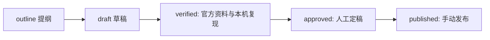

# 博客写作、验证、发布：项目内草稿单源

## 当前位置

- `content/blog/drafts/tools/`：24 篇**详细提纲**，状态 `outline`。
- `content/blog/drafts/series/`：三案例完整科普**长文草稿**，状态 `draft` / unverified。
- `content/blog/drafts/practices/`：A 确定性、B 视觉、C 自主 Agent **三篇长文草稿**，状态 `draft` / unverified。
- `content/blog/editorial/`：文章目录、发布批次、质量门禁、资料复核。
- `prompts/blog/`：每篇工具的写作 Prompt。

## 生命周期

**任何 `verified` 均须附实际工具版本、执行命令、退出码、截图/Trace/业务 Oracle 证据。** 静态检查和官方产品宣传不等于实测。

## 阶段触发与文章交付

文章随项目证据逐篇推进，不等到 Roadmap P7 才开始写作：

- **P3 确定性基线：** 优先把 Playwright Test 提纲推进为实战草稿；确定性路线草稿只写入已有运行证据支持的结论。
- **P4 视觉实验：** 根据实际运行的视觉工具和截图/Trace，推进视觉路线及对应工具文章。
- **P5 受限 Agent 探索：** 宿主隔离验收通过并取得 Agent 运行证据后，推进自主 Agent 路线及实际参与工具的文章。
- **P6 三路线对照：** 用统一案例与可比证据完善三案例科普和路线比较内容。
- **P7 最终 Review：** 对已完成验证的文章进行技术、QA、编辑 Review，并等待人工定稿和发布批准；此阶段不作为批量起草的前置条件。

每个阶段交接时，列出推进的草稿路径和状态。若没有草稿可推进，说明缺少哪项实测或审查证据。未执行内容继续标 `NOT RUN`；草稿更新不自动改变验证、批准或发布状态。

## 操作步骤

1. 选 `data/tool-catalog.json` 中一项，阅读对应 `tools/<slug>/README.md` 和文章提纲。
2. 用 `prompts/blog/tools/<序号>-<slug>.md` 研究并锁定版本；先核官方 README/Release/License。
3. 在已批准、可重置的 E1/M1/S1 Demo 中完成 Quick Start 和主案例；其它两个案例至少说明适用边界。
4. 写清楚功能、探索性测试、持续回归、CI、进阶、FAQ 与常见失败，保存真实证据；未执行处标 `NOT RUN`。
5. Technical Review → QA Review → Editorial Review → 人工批准。
6. 定稿从此仓库**手动**导入 `naodeng/inaodeng.com`；公众号与网站共享同一份 Markdown，不在博客项目编辑第二份互相矛盾的草稿。
7. 如发布后需要更新，先修改本仓库规范草稿，再审批同步；保留链接及核查日期。

## 为什么不是把所有工具写成相同深度

适合建设 UI 自动化的工具写完整篇，诊断/辅助工具写专题篇，评估工具写短篇。自动操作浏览器不意味着能独立承担 Test Runner、稳定断言和 CI。
