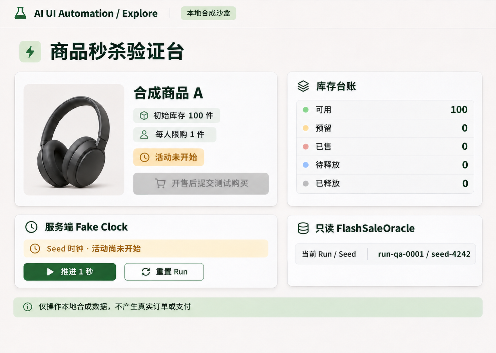

# S1 Flash Sale UI Baseline

**Status:** Visual proposal approved; the first local synthetic runtime slice is implemented and has passed targeted verification.

## Baseline

The page is a localhost-only synthetic QA console. It opens before the campaign start, shows a disabled purchase action, exposes a server Fake Clock control, separates the five stock buckets, and displays a read-only `FlashSaleOracle` area. Values such as the product name and Run/Seed labels in this concept are illustrative placeholders; implementation evidence is in the [S1 implementation review](../../../docs/reviews/P2-S1-review.en.md) and `evidence/s1/`.

## Contract mapping

- **S1-R01: PASS.** The button is disabled before start, the server rejects a purchase without changing stock, and the Fake Clock can advance to the start boundary.
- **S1-R02: PARTIAL.** The regression makes 100 serial purchases and rejects the 101st attempt; the page and Oracle show zero available, 100 sold, and zero in all other buckets. Concurrency and load scenarios were not run, so this does not prove the effective-sold limit under concurrent writes.
- **S1-R03: PASS.** After one synthetic user's successful purchase, a second purchase with a new idempotency key is rejected by the user limit.
- **S1-R04: PASS.** Replaying the same idempotency key returns the original order without adding stock movements or changing bucket counts.
- **S1-R05: NOT RUN.** The Oracle exposes stock buckets and movements; cancellation/timeout release paths are not implemented because their timing semantics are undefined.

## Out of scope for this proposal

- Real queue semantics, ordering guarantees, or an eventual-consistency SLA.
- Production traffic, browser-generated parallel writes, and load testing.
- Cancellation or timeout timing beyond the approved exactly-once release rule.
- Real product, account, purchase, or payment data.

Queue semantics, the eventual-consistency SLA, undefined cancellation/timeout release timing, and load testing remain outside this implementation. Server concurrency was not tested.

## Approval gate

The deterministic campaign start instant lives in the synthetic Seed as test data; it is not presented as a production policy. Any queue or reservation-lifecycle extension requires defined behavior first. Development remains directly on `develop`.
