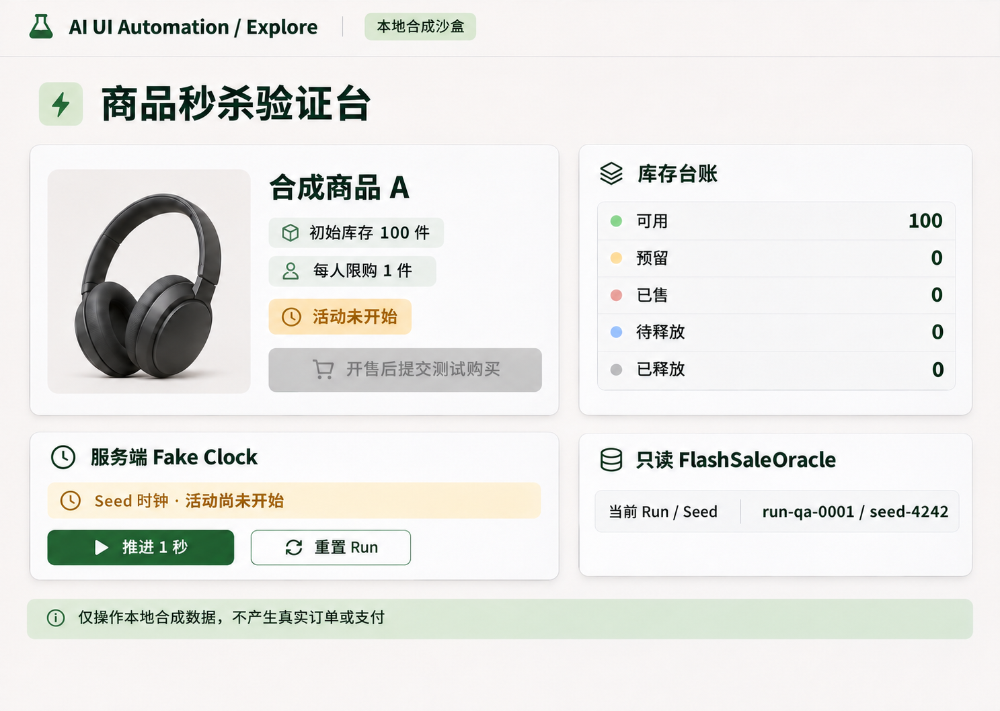

# S1 商品秒杀界面基线

**状态：** 视觉稿已批准；首个本地合成运行切片已实现并完成定向验证。

## 视觉基线

页面是仅限本机的合成 QA 控制台。初始画面处于开售前，购买操作禁用；页面展示服务端 Fake Clock、分别列出的五种库存状态和只读 `FlashSaleOracle` 区域。稿中的商品名称、Run/Seed 文本是示意占位；实现运行证据见 [S1 实现评审](../../../docs/reviews/P2-S1-review.md) 与 `evidence/s1/`。

## 契约映射

- **S1-R01：PASS。** 开售前按钮禁用，服务端拒绝购买请求且库存不变；Fake Clock 推进至开售边界后可购买。
- **S1-R02：PARTIAL。** 回归按顺序完成 100 笔购买并拒绝第 101 次尝试；页面与 Oracle 显示可用库存为 0、已售 100、其余库存桶为 0。没有运行并发或负载场景，不能据此证明并发下的有效售出上限。
- **S1-R03：PASS。** 同一合成用户购买成功后，以新幂等键再次购买会被限购拒绝。
- **S1-R04：PASS。** 重放同一幂等键返回原订单，库存桶和流水不增加。
- **S1-R05：NOT RUN。** Oracle 暴露库存桶和流水；取消/超时释放路径未实现，因为其时序语义尚未定义。

## 本方案不包含

- 真实排队语义、排序保证或最终一致性 SLA。
- 生产流量、浏览器发起的并行写入和负载测试。
- 超出“释放只生效一次”已批准规则的取消或超时细节。
- 真实商品、账号、购买或支付数据。

队列语义、最终一致性 SLA、未定义的取消/超时释放时序与负载测试仍在当前实现范围外。库存耗尽及服务端并发验证未运行。

## 审批门

固定的活动开售时刻作为合成 Seed 测试数据，不代表生产策略。后续扩展必须先获得明确的队列或预留生命周期规则；开发仍直接在 `develop` 进行。
